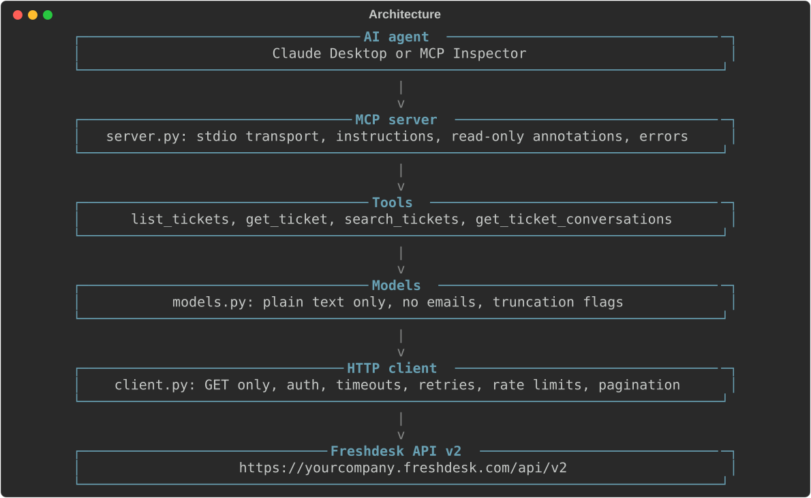
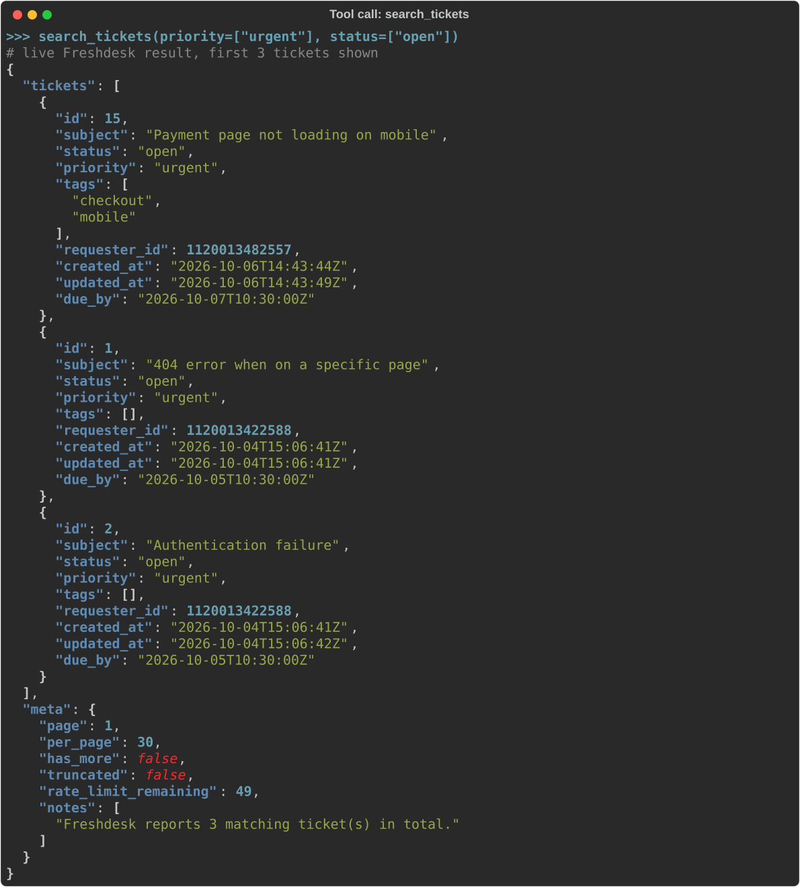
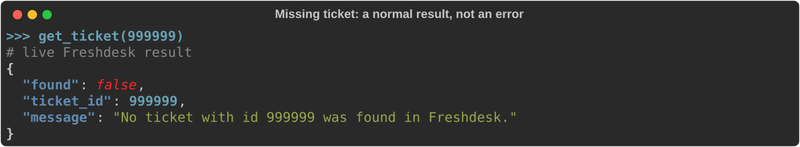

# freshdesk-mcp

A read-only Model Context Protocol (MCP) server that gives an AI agent safe access to Freshdesk
support tickets.


[](https://github.com/PPaul14/freshdesk-mcp-readonly/actions/workflows/tests.yml)




## Highlights

- **Read-only by design.** The HTTP client can only send `GET` requests; it has no method
  parameter and no write code path. Every tool is also annotated as read-only for MCP clients.
- **Rate-limit aware.** Retries honour `Retry-After` within a 30-second time budget, and when a
  wait is too long the agent is told exactly how many seconds to wait.
- **No customer emails sent to the model.** Requester emails, phone numbers, HTML bodies and
  attachment contents never leave the connector.
- **56 automated tests.** All HTTP is mocked. A mutation check, re-introducing a real bug found
  against live Freshdesk, confirmed that the suite fails when it should.
- **Evaluated against a live agent.** The demo questions, results and the before/after evaluation
  are in [demo/demo.md](demo/demo.md).

The agent can list, look up and search tickets and read their conversation threads. It cannot
reply to, update, assign, merge or close tickets. A full account of what it can and cannot do,
its failure modes and its data boundaries is in [CAPABILITIES.md](CAPABILITIES.md).

## Tools

| Tool | Purpose |
|---|---|
| `list_tickets` | Recent tickets, newest first, optionally filtered by status and priority |
| `get_ticket` | One ticket by id, with description, requester name and optionally the first 10 messages |
| `search_tickets` | Tickets matching status, priority, a tag, and created/updated date ranges |
| `get_ticket_conversations` | A ticket's full thread, oldest first, page by page |

The exact tool schemas and server instructions the agent receives are in
[`mcp_tools.json`](mcp_tools.json).

A live `search_tickets` call returns validated, plain-text results with paging metadata and notes
for the agent:



A ticket that does not exist is reported as a normal result, so the agent can state it rather
than treat it as a failure:



**Limitations:**

- No free-text search: tickets cannot be found by words in their subject or body.
- `list_tickets` without `updated_since` covers only tickets created in the last 30 days
  (a Freshdesk default).
- Search returns 30 results per page and at most 10 pages (300 tickets).
- Long descriptions (2,000 characters) and message bodies (1,500 characters) are truncated and
  flagged.

## Rate limiting and error handling

- **Retries.** HTTP 429, 500, 502, 503 and 504 responses and network failures are retried up to
  three times. HTTP 400, 401, 403 and 404 are never retried.
- **Waiting.** A `Retry-After` header is honoured exactly. Otherwise the client uses exponential
  backoff (1, 2, 4 seconds, capped at 8) with up to 0.5 seconds of random jitter.
- **Time budget.** Total waiting per call is limited to 30 seconds. If a required wait exceeds the
  remaining budget, the call fails immediately and reports the wait.
- **Pacing.** When Freshdesk reports fewer than five remaining calls, the client pauses for one
  second before the next request.
- **Typed errors.** Failures reach the agent as `[code] message`, for example `[auth_failed]` or
  `[rate_limited]`. Unexpected exceptions are reported only as `[internal_error]`; the traceback
  goes to the server log. No error message contains the API key, auth headers or credentialed URLs.


## Prerequisites

- **Python 3.11 or newer** (check with `python --version`).
- **A Freshdesk account** and its **API key**. A free trial account is sufficient.
- **Node.js** (optional), to run MCP Inspector.
- **Claude Desktop** (optional), to use the tools from a chat client.

## Setup

### 1. Install

Windows (PowerShell), from the project folder:

```powershell
python -m venv .venv
.\.venv\Scripts\Activate.ps1
python -m pip install --upgrade pip
pip install -e ".[dev]"
```

If activation fails with "running scripts is disabled on this system", run
`Set-ExecutionPolicy -Scope CurrentUser RemoteSigned` once, then activate again.

macOS / Linux:

```bash
python3 -m venv .venv
source .venv/bin/activate
python -m pip install --upgrade pip
pip install -e ".[dev]"
```

### 2. Configure Freshdesk credentials

Copy the example file (`Copy-Item .env.example .env` on Windows, `cp .env.example .env` elsewhere)
and set both values:

```dotenv
FRESHDESK_DOMAIN=yourcompany.freshdesk.com
FRESHDESK_API_KEY=your-api-key
```

- `FRESHDESK_DOMAIN` is the host only, without `https://` or a trailing `/`.
- The API key is in Freshdesk under **profile picture > Profile Settings > View API Key**. If
  requests later fail with HTTP 401, confirm that API access is enabled for the agent in
  **Admin > Agents**.
- `.env` is excluded from version control. Do not commit it or place the key in code, issues or
  logs.

### 3. Verify the connection

```bash
python scripts/smoke_test.py
```

The script sends a small number of `GET` requests and prints the ticket count, the first ticket,
the rate-limit figures and a search total. It then confirms that an invalid key produces a clean
`AuthError`. If it prints `FAILED [...]`, see [Troubleshooting](#troubleshooting).

### 4. Add test tickets (optional)

An empty helpdesk gives the agent nothing to read. `scripts/seed_tickets.py` creates 15 fictional
tickets with conversations; all requesters use `example.com` addresses.

```bash
python scripts/seed_tickets.py --dry-run   # print the plan without calling the API
python scripts/seed_tickets.py             # create the tickets (approximately 2 minutes)
```

> **This script writes to Freshdesk.** Run it only against a trial or test account. Running it
> twice creates duplicates. Agent replies trigger emails to `example.com` addresses, which are
> undeliverable by design. The connector never imports or calls this script.

## Running the server

The server communicates over **stdio**: an MCP client starts it as a subprocess and exchanges
messages through its standard input and output. It is not normally started by hand. When started
directly (`freshdesk-mcp` or `python -m freshdesk_mcp.server`), it writes one log line and then
waits for a client; this is the expected behaviour. Press `Ctrl+C` to stop it.

### MCP Inspector

```powershell
npx @modelcontextprotocol/inspector "<path-to-repo>\.venv\Scripts\python.exe" -m freshdesk_mcp.server
```

On macOS and Linux, use `<path-to-repo>/.venv/bin/python`. Open the URL that Inspector prints,
select **Connect**, then **Tools > List Tools**.

### Claude Desktop

Add the following to `claude_desktop_config.json`. Create the file if it does not exist; if it
does, keep its existing content and merge the `freshdesk` entry into `mcpServers`.

```json
{
  "mcpServers": {
    "freshdesk": {
      "command": "<path-to-repo>\\.venv\\Scripts\\python.exe",
      "args": ["-m", "freshdesk_mcp.server"]
    }
  }
}
```

Use the full path to the virtual environment's Python (`<path-to-repo>/.venv/bin/python` on macOS
and Linux). Windows backslashes must be doubled in JSON. No `env` block is required: the server
reads `.env` from the project folder regardless of the working directory Claude Desktop uses.

Configuration file locations:

| Installation | Path |
|---|---|
| Windows (installer from claude.ai) | `%APPDATA%\Claude\claude_desktop_config.json` |
| Windows (Microsoft Store) | `%LOCALAPPDATA%\Packages\Claude_<id>\LocalCache\Roaming\Claude\claude_desktop_config.json` |
| macOS | `~/Library/Application Support/Claude/claude_desktop_config.json` |

Fully quit Claude Desktop (from the system tray or menu bar, not only the window) and reopen it.
The four tools then appear in the tools menu.

## Testing

```bash
pytest                      # all HTTP is mocked; no Freshdesk account is required
ruff format . && ruff check .
```


After changing a tool signature, a tool description or the server instructions,
`tests/test_tool_specs.py` fails until the specification file is regenerated and committed:

```bash
python scripts/export_tool_specs.py
```

The images in this README are generated from real command and tool output, and each is checked
for credentials and personal details before it is written:

```bash
python scripts/make_readme_images.py      # requires a configured .env; read-only
```

## Troubleshooting

| Symptom | Resolution |
|---|---|
| `[config_error] Missing or empty environment variable(s)` | `.env` is missing or a value is empty. The file must be located next to `pyproject.toml`. |
| `.env` is complete but values appear empty | A variable of the same name set in the shell or system environment takes precedence over `.env`. In PowerShell, check with `Test-Path env:FRESHDESK_API_KEY` and remove it with `Remove-Item env:FRESHDESK_API_KEY`, or open a new terminal. |
| `[auth_failed] ... (HTTP 401)` | The API key is incorrect, or API access is disabled for the agent in **Admin > Agents**. |
| `[rate_limited] ... retry after N seconds` | The Freshdesk per-minute limit was reached (50 per minute on trial accounts). The client has already retried; wait the number of seconds stated. |
| Tools do not appear in Claude Desktop | Confirm the configuration path for the installation type (see above), that the `command` path exists, and that the application was fully restarted. Server logs are in the `logs` folder next to the configuration file (`mcp-server-freshdesk.log`). |

The server logs to standard error only, because standard output carries the MCP protocol.

## Project layout

```
src/freshdesk_mcp/
  server.py        MCP server: tool registration, instructions, error mapping
  client.py        Read-only HTTP client: auth, timeouts, retries, rate limits, pagination
  errors.py        Typed errors (auth_failed, not_found, rate_limited, ...)
  models.py        Agent-facing data: plain text, no emails, truncation flags
  tools/           The four tool functions and shared input validation
scripts/
  smoke_test.py            Live connection check (read-only)
  seed_tickets.py          Creates fictional test tickets (writes to Freshdesk)
  seed_data.json           The fictional tickets
  export_tool_specs.py     Regenerates mcp_tools.json
  make_readme_images.py    Regenerates the README images in docs/images/
tests/                     pytest suite (HTTP mocked with responses)
docs/images/               README images generated from real output
mcp_tools.json             Generated: server instructions and tool schemas
CAPABILITIES.md            What the agent can and cannot do
demo/demo.md               Demo questions and evaluation
```
